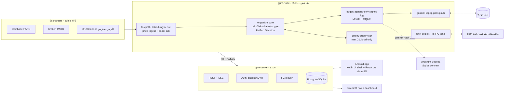

# معماری DeFi، اپ اندروید و شبکه‌ی ارگانیسم‌ها (طرح Rust-only)

> وضعیت: پیشنهاد طراحی (Design Doc) — مبنا: `main` @ `29673b2`
> اصل ثابت: همه‌چیز **paper-trading** است. هیچ توکن با ارزش واقعی، هیچ نگهداری پول دیگران (custody)، هیچ معامله‌ی واقعی بدون تصمیم جداگانه‌ی مالک و بررسی حقوقی.

## ۱. خلاصه
تمام اجزای جدید به **Rust** نوشته می‌شوند: ledger، هسته‌ی ارگانیسم، هسته‌ی اپ اندروید (از طریق `uniffi`)، سرور (`axum`)، gossip بین نودها، CLI و Unix socket برای برنامه‌های لینوکس، و قرارداد هوشمند testnet (روی **Arbitrum Stylus**). سرویس Go فعلی (`fastpath-go`) به Rust (`tokio` + `tokio-tungstenite`) منتقل می‌شود؛ Go فقط به‌عنوان fallback موقت باقی می‌ماند تا نسخه‌ی Rust هم‌ارزی خود را در تست‌ها ثابت کند. UI فعلی Streamlit (Python) تا وقتی اپ و داشبورد جدید آماده شوند حفظ می‌شود.

### چرا Rust برای همه‌چیز؟
- یک زبان، یک workspace (`cargo`)، یک مجموعه type مشترک (`gpm-types`) برای ledger، سرور، اپ و قرارداد → هیچ ناهماهنگی در serialization و امضا.
- حافظه‌ی قابل‌پیش‌بینی بدون GC (برای کلونی ۲۱تایی مهم است؛ هدف < ۳۰ MB برای هر نود به‌جای ~۱۵۱ MB فعلی Python).
- `native/` (arena loop با Rust) از قبل وجود دارد و ۱۴۹ برابر سریع‌تر است؛ هسته‌ی ارگانیسم روی همان ساخته می‌شود.
- `uniffi` اجازه می‌دهد همان crate روی Android (ARM64) اجرا شود؛ Kotlin فقط پوسته‌ی نازک UI است.
- Stylus قرارداد Rust→WASM را روی زنجیره‌ی سازگار با EVM اجرا می‌کند؛ نیاز به Solidity نیست.

## ۲. نمودار اجزا


## ۳. اجزا و پروتکل‌های بین آن‌ها
| مسیر | پروتکل | توضیح |
|---|---|---|
| صرافی → fastpath | WebSocket عمومی (بدون کلید) | فقط داده‌ی قیمت؛ کلید Coinbase فقط-خواندنی برای موجودی، جدا و اختیاری |
| fastpath → organism | in-process channel (`tokio::mpsc`)، ring buffer ثابت | بدون allocation در hot path |
| node ↔ Python فعلی | HTTP `127.0.0.1:8787` (همان API فعلی Go) | سازگاری عقب‌رو؛ Streamlit تغییر نمی‌کند |
| node ↔ برنامه‌های لینوکس | Unix socket `/run/gpm/gpm.sock` با gRPC (`tonic`) + JSON-lines ساده | دسترسی با permission فایل |
| node ↔ server | HTTPS: `POST /v1/decisions`، SSE `GET /v1/stream` | امضای Ed25519 روی هر رکورد |
| server ↔ Android | REST + SSE + FCM push | push فقط «سیگنال جدید»، بدون داده‌ی حساس |
| node ↔ node | `libp2p` (gossipsub + Noise + Kademlia) | فاز اول: لیست bootstrap دستی (allowlist) |
| ledger → زنجیره | JSON-RPC به Arbitrum Sepolia (`alloy`) | فقط hash/commitment، هر N دقیقه یک batch |

**Unified Decision** (همان اصل PR #7) در Rust هم حفظ می‌شود: یک `struct Decision { ts, price_paxg, signal: Long|Short|Wait, confidence, risk, whales, oxygen, genome_id }` در هر tick یک بار ساخته می‌شود و همه‌ی نمایش‌ها (کارت سیگنال، «با کمک رسول واحد»، عقربه، تست ۲ یورویی، اپ اندروید) فقط آن را می‌خوانند.

## ۴. Ledger (Rust)
- **ساختار:** append-only log. هر entry: `{seq, prev_hash, ts, kind, payload, node_pubkey, sig}`؛ hash = BLAKE3، امضا = Ed25519 (`ed25519-dalek`).
- **Merkle:** هر ۶۰ ثانیه یک Merkle root از entryهای جدید (checkpoint) ساخته می‌شود؛ همین root است که در فاز ۱ روی testnet ثبت می‌شود.
- **ذخیره:** SQLite (`rusqlite`, WAL) — یک فایل، قابل backup و inspect. (`redb` جایگزین embedded خالص Rust.)
- **اجماع:** هیچ PoW/PoS. هر نود فقط log خودش را می‌نویسد (single-writer)؛ نودهای دیگر فقط امضا و زنجیره‌ی hash را verify می‌کنند. تضادی وجود ندارد چون مالکیت هر log مشخص است → سبک و بدون مصرف انرژی.
- **سبک ماندن:** pruning بعد از checkpoint (نگه‌داشتن root + ۳۰ روز آخر)، entry < ۵۰۰ بایت، هدف دیسک < ۱۰۰ MB/سال، RAM < ۳۰ MB.
- **انواع entry:** `Decision`, `PaperTrade{open/close, price, pnl}`, `GenomeFitness`, `Commit/Reveal`, `PeerAttestation`.

## ۵. هوش جمعی: چه چیزی بین نودها به اشتراک گذاشته می‌شود
**به اشتراک گذاشته می‌شود:** نتیجه‌ی سیگنال‌ها (بعد از reveal)، fitness ژنوم‌ها، پارامترهای ژنوم (نه داده‌ی خام کاربر)، checkpoint های ledger.
**هرگز:** کلیدهای API، کلید خصوصی نود، موجودی حساب، هویت/ایمیل کاربر، IP جز آنچه libp2p لازم دارد.

**یادگیری federated-style:** هر نود ژنوم‌های برتر خود را با fitness امضاشده منتشر می‌کند؛ نودهای دیگر آن‌ها را **روی داده‌ی محلی خود دوباره بک‌تست می‌کنند** و فقط اگر بهتر بود در arena وارد می‌کنند. یعنی هیچ ادعایی بدون تأیید مستقل پذیرفته نمی‌شود.

**دفاع در برابر poisoning و sybil:**
- fitness ادعایی معتبر نیست؛ فقط track record commit-reveal روی ledger (قبل از نتیجه commit شده) حساب می‌شود.
- re-validation محلی اجباری + محدودیت نرخ (مثلاً ≤ ۵ ژنوم/ساعت از هر peer).
- وزن reputation بر اساس سن و طول track record قابل‌تأیید؛ نود جدید وزن ≈ ۰.
- فاز اول فقط peer های allowlist (نودهای خود مالک)؛ باز کردن شبکه بعداً.
- خوشه‌بندی ژنوم‌های تقریباً یکسان از چند peer برای کشف sybil.

## ۶. پروتکل DeFi (فازبندی)
### فاز ۰ — ledger امضاشده‌ی off-chain (MVP)
هر Decision و PaperTrade در ledger محلی، امضا و gossip می‌شود. track record قابل‌تأیید، بدون هیچ زنجیره‌ای و هزینه‌ای.

### فاز ۱ — قرارداد testnet فقط برای commitment
- **زنجیره:** **Arbitrum Sepolia با Stylus** (Rust → WASM). دلیل: Rust خالص، سازگار با EVM و ابزارهای Ethereum (wallet، explorer)، gas پایین، ETH testnet رایگان از faucet. جایگزین بررسی‌شده: Solana devnet + Anchor (Rust هم هست، ولی مدل حساب متفاوت و ابزار جدا)؛ ink! به دلیل اکوسیستم کوچک‌تر کنار گذاشته شد.
- **commit-reveal:** پیش از هر سیگنال: `commit = keccak256(signal || price || ts || salt)` ثبت می‌شود. پس از بسته شدن معامله‌ی کاغذی: `reveal(signal, price, ts, salt)` → قرارداد تطابق را بررسی و نتیجه را ثبت می‌کند. همچنین `anchor(merkle_root)` برای checkpoint های ledger.
- **بدون توکن با ارزش.** هیچ deposit، هیچ pool، هیچ transfer.
- توابع: `commit(bytes32)`, `reveal(...)`, `anchor(bytes32 root, uint64 seq)`, `get_record(node)`.

### فاز ۲ — اختیاری، فقط بعد از بررسی حقوقی
هر چیزی شامل ارزش واقعی (توکن، vault، copy-trading، کارمزد) فقط پس از نظر وکیل متخصص و audit مستقل قرارداد. پیش‌فرض: انجام نمی‌شود.

## ۷. حقوقی و ریسک (آلمان / EU) — مهم
- انتشار یا عرضه‌ی توکن در EU مشمول **MiCA** است (whitepaper، اطلاع‌رسانی/مجوز). ارائه‌ی خدمات crypto-asset به دیگران مجوز CASP لازم دارد.
- جمع کردن پول دیگران و معامله برای آن‌ها = **مدیریت دارایی / portfolio management** → مجوز **BaFin** طبق **KWG/WpIG/KAGB**. فعالیت بدون مجوز در آلمان جرم کیفری است.
- ارائه‌ی «سیگنال» به دیگران می‌تواند مشاوره‌ی سرمایه‌گذاری تلقی شود؛ متن «توصیه‌ی مالی نیست» و «فقط کاغذی» در همه‌جا لازم است (از جمله بخش «با کمک رسول واحد»).
- **توصیه:** بدون توکن، بدون custody، بدون pool. فقط پول و کلید خود مالک.
- قبل از هر mainnet: audit مستقل قرارداد، تست fuzz، و bug bounty.
- GDPR: سرور حداقل داده نگه دارد؛ هیچ داده‌ی شخصی روی ledger/زنجیره (غیرقابل حذف است).
- کلید Coinbase که در چت دیده شده باید rotate شود.

## ۸. اپ اندروید + سرور
**اپ:**
1. مرحله‌ی A (فوری): PWA / WebView از داشبورد فعلی، APK sideload روی Pixel.
2. مرحله‌ی B: Kotlin + Jetpack Compose فقط برای UI؛ منطق (Decision، ledger verify، ارگانیسم سبک) در crate `gpm-core` با `uniffi` و `cargo-ndk` برای `arm64-v8a`.
3. اپ به‌صورت پیش‌فرض **client** است (از سرور می‌خواند)؛ حالت «light node» اختیاری فقط روی Wi-Fi و شارژ (WorkManager).
- انتشار در Google Play حساب ۲۵ دلاری لازم دارد — فقط با اجازه‌ی مالک.

**سرور (`gpm-server`, axum):** auth با passkey/WebAuthn یا JWT کوتاه‌مدت، REST + SSE، ارسال push با FCM HTTP v1 (رایگان)، DB: SQLite در شروع → Postgres در صورت نیاز. میزبانی: VPS ارزان مالک یا لپ‌تاپ + Cloudflare Tunnel (رایگان). هیچ حساب پولی بدون اجازه.

## ۹. اتصال برنامه‌های لینوکس
- باینری `gpm` (CLI): `gpm status`, `gpm decision --watch`, `gpm ledger verify`, `gpm peers`, `gpm colony ls`.
- socket: `/run/gpm/gpm.sock` (gRPC `tonic`) + endpoint ساده‌ی JSON-lines برای اسکریپت‌ها:
  `echo '{"op":"subscribe","topic":"decision"}' | socat - UNIX-CONNECT:/run/gpm/gpm.sock`
- SDK: crate `gpm-sdk` (Rust) + فایل `.proto` تا هر زبانی client بسازد؛ نمونه‌های `examples/` (Rust، bash، Python).
- systemd unit:
```ini
[Unit]
Description=gold-phase-monitor node
After=network-online.target
[Service]
ExecStart=/usr/local/bin/gpm-node --config /etc/gpm/node.toml
User=gpm
RuntimeDirectory=gpm
MemoryMax=256M
NoNewPrivileges=yes
ProtectSystem=strict
StateDirectory=gpm
Restart=on-failure
[Install]
WantedBy=multi-user.target
```
- plugin ها فقط می‌خوانند و paper-signal پیشنهاد می‌دهند؛ هیچ plugin ای به کلید یا اجرای معامله دسترسی ندارد.

## ۱۰. ساختار repo
```
rust/            # cargo workspace
  gpm-types/  gpm-ledger/  gpm-fastpath/  gpm-core/  gpm-node/
  gpm-server/ gpm-cli/     gpm-sdk/       gpm-mobile/ (uniffi)
contracts/stylus-commit/   # Arbitrum Stylus, Rust
android/                   # Kotlin UI shell
fastpath-go/               # fallback تا پایان مهاجرت، سپس حذف
native/                    # arena loop فعلی → به gpm-core منتقل می‌شود
app.py, core/              # Streamlit فعلی (بدون تغییر در MVP)
```

## ۱۱. نقشه‌ی راه (MVP اول)
| # | Milestone | خروجی | تخمین |
|---|---|---|---|
| M0 | PWA/WebView APK | آیکون روی Pixel | ۰.۵ روز |
| M1 | پورت fastpath به Rust | `gpm-fastpath` با همان API `:8787`، تست هم‌ارزی با Go | ۳–۴ روز |
| M2 | ledger فاز ۰ | `gpm-ledger` + `gpm ledger verify` + SQLite | ۴–۵ روز |
| M3 | Unified Decision در Rust | `gpm-core` (ادغام `native/`)، Python از آن می‌خواند | ۵–۷ روز |
| M4 | CLI + Unix socket + systemd | `gpm`, `gpm-sdk`, examples | ۳ روز |
| M5 | سرور axum + FCM | REST/SSE/push، auth | ۵–۷ روز |
| M6 | اپ native (Compose + uniffi) | APK، push سیگنال | ۲–۳ هفته |
| M7 | gossip libp2p (allowlist) | ۲+ نود خود مالک، اشتراک fitness با re-validation | ۱–۲ هفته |
| M8 | قرارداد Stylus روی Arbitrum Sepolia | commit-reveal + anchor، بدون توکن | ۱ هفته |
| M9 | حذف fastpath-go و Python hot path | فقط Rust + UI | ۲–۳ روز |
| — | فاز ۲ | فقط پس از بررسی حقوقی و audit | نامشخص |

**MVP = M0 + M1 + M2 + M4** (حدود ۲ هفته): اپ روی گوشی، fastpath با Rust، ledger امضاشده و CLI لینوکس.

## ۱۲. معیارهای پذیرش
- تست هم‌ارزی: خروجی Rust با Python/Go فعلی یکسان (مانند PR #9).
- RAM هر نود < ۳۰ MB، بدون نشت در تست ۲۴ ساعته.
- `gpm ledger verify` روی ledger نود دیگر موفق؛ دستکاری یک بایت → شکست.
- هیچ مسیری در کد برای ارسال سفارش واقعی وجود ندارد (تست CI که این را بررسی می‌کند).
